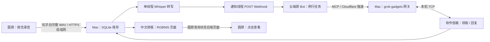

# 圆屏语音：架构、耗时与优化方案

> 后续实施状态：[云端流程与局部刷新已实施；含实机对照结果](../implementation/overall-throughput.md)。下文保留当时的分析与方案。
分析日期：2026-10-17。依据：仓库 `0b60829` 加当前未提交的自动触发实现，正在运行的 voice bridge 0.3.0，以及两次真实自动处理记录。用户已确认链路接通。本次仅分析、离线测量和编写方案，没有更改运行服务、Bot 任务或设备固件。

**结论：优先缩短原 Bot 的处理链，而不是先换语音识别。** 两次请求在转写结束、开始通知之后，仍分别经过 40.34 秒和 30.38 秒才保存回复。本机 5.46 秒测试音频的转写中位数为 0.88 秒，单页排版约 0.012 秒。云端调度、模型、非 MCP 工具和网络各自占多少，目前还不能拆开。

默认继续由已有「毛线」处理所有语音，保留记忆、工具和授权边界。另一个 Bot 或直接模型 API 不是同一产品；简单问题走快速模型只列为有条件的备选。

## 1. 当前架构

这里有两条网络路径：音频和页面直接走圆屏与 Mac 的局域网 HTTPS；Bot 工具调用通过公网 MCP 和 Cloudflare 回到 Mac。云端接收转写文字，不通过这条链路接收原始音频。

| 阶段 | 当前实现 | 对速度的影响 |
|---|---|---|
| 录音 | 48 kHz、16-bit、单声道，PCM 放 PSRAM，最长 30 秒；正常松手触发发送 | 没有边录边传、边录边转写 |
| 上传 | 完整 WAV，约 96 KB/秒；5 秒约 480 KB，30 秒约 2.88 MB | 上传完成并保存后才开始 ASR；设备上传耗时尚未测到 |
| 本机转写 | faster-whisper `base`、CPU、int8、VAD；自动识别语言，默认 beam=5 | 一个工作线程；后续录音排队；模型在首次任务时加载 |
| 自动唤醒 | ready 与待通知状态同事务写入；独立线程发送真实 routine webhook | 首个可发送请求不固定等 15/120 秒；连续通知最短间隔 15 秒 |
| Bot 处理 | 当前实测 list → get_state → claim → 处理 → reply；另有进度保存要求 | 多个工具/模型回合，且需等待云端启动 |
| MCP 回传 | 公网网关 → 软件信箱；信箱每 0.2 秒 poll，约 1 秒更新摘要 | 两个样本的 claim/reply 网关内部执行均低于 0.4 秒 |
| 页面 | Mac 将最多 128 字符的回复排为 272×168 RGB565 页，每页 91,408 字节 | 缓存字体；渲染仍在 Store 全局锁内，但实测不是大头 |
| 圆屏呈现 | 等待任务时每次请求结束后等 2 秒；待机收件箱等 5 秒；点击查看才下载页面 | 查询间隔之外还有 TLS/传输和用户点击时间；不能把 replied 当成已经显示 |

状态所有权清楚：Mac SQLite 持有音频、正文、领取和不可变回复；Bot 决定要做什么及执行外部任务；圆屏负责录音和显示。保留这个分工可以继续利用原 Bot，同时让传输与去重保持确定性。

主要源码：

- [录音、发送与轮询](../../firmware/grokbot/main/voice.cpp)：`send` 158 行，`load_page` 173 行，轮询 333 行。
- [HTTP 生命周期](../../firmware/grokbot/main/voice_http.cpp)：每次创建客户端并 cleanup；[服务响应](../../voice_bridge/src/voice_bridge/server.py) 92 行显式 `Connection: close`。
- [ASR 工作线程](../../voice_bridge/src/voice_bridge/worker.py) 13、19、45、55 行。
- [持久状态与通知](../../voice_bridge/src/voice_bridge/store.py) 145、170、248、265 行。
- [软件信箱](../../voice_bridge/src/voice_bridge/mailbox.py) 129 行；[例行任务指令](../../voice_bridge/src/voice_bridge/grok-routine.txt)。
- [排版](../../voice_bridge/src/voice_bridge/render.py)；[CLI 预加载](../../voice_bridge/src/voice_bridge/cli.py) 81 行。

## 2. 实际慢在哪里

以下均为同一台 Mac 的时间戳。起点是 `notify_last_at`，即发送通知前的持久预留时间；不是按键释放时间，也不是收到 webhook 200 的时间。终点来自网关完成工具处理后的日志。时间包含通知 HTTP、云端、工具之间的间隔和网络，并未包含前面的录音、上传、转写，以及后面的物理显示。

| 从通知预留开始 | 合成语音测试，5.46 秒 | 实体设备请求，5.56 秒 |
|---|---:|---:|
| Bot 第一次列设备完成 | 11.04 秒 | 9.88 秒 |
| 读取信箱状态完成 | 11.68 秒 | 10.41 秒 |
| 领取成功 | 22.02 秒 | 18.15 秒 |
| 回复保存成功 | **40.34 秒** | **30.38 秒** |
| claim 在网关内处理时间 | 0.148 秒 | 0.085 秒 |
| reply 在网关内处理时间 | 0.379 秒 | 0.316 秒 |

两次都只发送了 **一次** 通知。没有 120 秒重试；第二次与第一次相隔数分钟，也没有命中 15 秒连续通知间隔。

可以确认的是：转写结束以后还有 30～40 秒等待，大部分不在本机 claim/reply 执行里。不能据此声称“模型思考花了 30 秒”或“Cloudflare 很慢”：未记录 Bot 内部启动、上下文准备、文件进度保存与模型调用的独立耗时。列设备和读状态本身只花毫秒，删掉它们能否省下多秒取决于是否减少模型往返，必须复测。

[脱敏时间线](voice-latency-evidence/gateway-timeline.json)只保留阶段、时间与耗时，没有凭据、正文或音频。

## 3. 本机实测：ASR 和排版

环境：Apple M4，16 GiB 内存，10 个逻辑 CPU；faster-whisper 1.2.1、CTranslate2 4.8.3、PyAV 16.1.0。使用之前合成的 5.455 秒中文 WAV，523,756 字节。模型在测量进程中先加载；每种设置各跑 5 次，按 A→B→C 交错，完整消费转写生成器。系统有其他工作，运行前后 load average 约 4.1→4.4，样本有升温/负载漂移。没有向生产 Bot 发送额外测试。

| 配置 | 中位数 | 最小～最大 | 内容核对 |
|---|---:|---:|---|
| 现配置：自动语言、beam=5 | 0.876 秒 | 0.678～1.057 秒 | “圆屏”误成“圓平” |
| 指定中文、beam=5 | 0.616 秒 | 0.481～0.669 秒 | 本句输出与现配置相同 |
| 指定中文、beam=1 | 0.458 秒 | 0.366～0.507 秒 | “圓平”变成“原平”，输出已有变化 |

现配置与指定中文在这一句上有可测差异，约节省 0.26 秒；这不足以解释或解决 30～40 秒等待。beam=1 虽更快，但当前样本已经存在术语识别错误，不能仅凭一个合成句选型。应增加真实麦克风、噪声、数字、专名、中英混合和否定指令样本，先检查内容准确性。

同一新进程中模型加载 0.366 秒，首次转写 0.850 秒；这是进程首次加载，磁盘缓存没有清空，不能代表系统冷启动的最坏情况。另起进程运行 `--preload-model` 只会下载/加载后退出，无法替代正在服务的进程内预热。

单页回复排版五次中位数 **0.0118 秒**，范围 0.0115～0.0133 秒，五次页面哈希一致；首次字体初始化 0.077 秒。Python 像素循环确实可以优化，但在这条短回复链路上优先级很低。长回复、多页和并发情况下的锁阻塞另测。

独立 profiling 显示此样本 ASR 热点是编码/解码，音频 decode 约 0.022 秒、VAD 约 0.034 秒；profiling 结果不计入上述正式耗时。原始[结果](voice-latency-evidence/local-benchmark.json)、[测量脚本](voice-latency-evidence/benchmark-original.py)、[profile](voice-latency-evidence/asr-profile.txt)均保留。脚本复用 `/tmp/my-bot-auto-reply-test.wav`，不读用户录音，输出到 `/tmp/my-bot-latency`。

## 4. 推荐优化：保留原 Bot，分三步推进

### 第一步：补齐分段时间，精简 Bot 正常路径

**这是当前收益最可能大的地方。**

正常路径目标：已知 mailbox ID → 持久保存本次 run 的 claim ID → `voice.claim` 同时取得正文 → 原 Bot 处理 → `voice.reply`。设备目录查询和状态探测移到离线、能力不匹配等异常恢复分支。当前 claim 已经返回第一页正文，无须另外 read；只有 `next_offset` 非空再分页读取。

- 固定连接、mailbox ID、工具和字段，减少 Bot 每次重新探索环境；核对重连后的标识及直接调用契约，定位失效才重新发现，不硬编码临时状态。
- 简短回答先保存到圆屏，再写聊天中的解释。可以缩短例行指令中重复说明，但保留重试、授权和不确定执行规则。
- 原 run 的 claim ID 必须先持久保存；收到 `accepted/dispatched` 才查命令状态。领取冲突立即退出，不把重复通知当新任务。
- 对外部动作继续保留 started/结果检查点。不要为了快删除防重复执行机制，也不要把“回复早一点”当成任务已经完成。
- 增加各阶段事件：接收完成、转写开始/结束、通知开始/结束、领取、回复提交、首屏收到/绘制。只记录 ID、阶段、耗时、错误；默认不写正文、音频和密钥。

计时模型：Mac 内部使用单调时钟算阶段耗时，跨设备不直接相减墙钟。圆屏从松手到首屏绘制用设备自身时钟；Mac 用同一 request_id 关联服务阶段。记录进程 boot ID 以区分重启前后时钟；阶段事件随状态事务提交。分别报告“已保存回复”和“用户已看到”，不混成一个完成指标。

验收：固定一句简单请求，修改前后至少各 5 次交错运行，记录 Bot 调用了哪些工具及耗时，检查回复内容一致、无重复动作。实体端另外记录按键释放→首屏、失败率。短期只以真实测得的下降作为收益，不承诺固定 3 秒或 10 秒返回。

### 第二步：减少圆屏最后一段等待

这是体感优化，与云端加速分开验收。

- 当前前台等待的请求收到 replied 后，自动下载并展示第一页；后台到达的回复保持未读提示，避免抢占其他页面。只在真正展示/用户确认后处理已读语义。
- 修正 `voice_ui.cpp:241` 仍要求“在 Bot 中说 处理圆屏语音”的旧文案；自动触发已接通，该提示不再匹配实际流程。
- 准确区分“转写中”“等待毛线”“毛线处理中”“回复已到”。现有 stored/transcribing/ready/claimed/replied 足够支持主要阶段；不显示假的进度百分比。
- 首轮优先保留现有轮询和传输协议，验证自动首屏是否改善体验。若仍受轮询影响，等待期间短时提高查询频率，遇到慢任务退避；控制连接数和耗电。
- 若测到 TLS 占明显比例，再一起改固件客户端复用和服务端 keep-alive，设置连接空闲期限及请求预算。目前服务端强制 close，单改固件不会复用成功。

正常无故障时，主动等待轮询可额外增加接近 0～2 秒调度等待，待机接近 0～5 秒，外加请求本身耗时。轮询优化只能处理这一段，无法去掉前面的 30 秒。

### 第三步：按证据优化音频和本机资源

- 服务进程内预热模型和字体，将初始化失败明确暴露。它改善首次请求的一致性，不会大幅改善已热身的日常请求。
- 中文语言提示作为可配置候选；用户需要英文或混合语言时不能硬锁中文。保留 beam=5 作为质量基线，先测准确率再决定 beam=1。
- 只有真实设备上传耗时明显时才改 16 kHz PCM：体积从 96 KB/s 降到 32 KB/s，减少约 67%。必须有正确低通重采样，不能简单每三点丢两点。硬件采集配置、WAV 校验、最短/最长字节限制、测试和兼容协议一起迁移。
- 流式上传/增量 ASR 放后面：它能与说话重叠，但要引入会话、分片、重传、取消和最终确认。松手前的临时识别不能直接触发外部任务；针对当前不足 1 秒的 ASR，复杂度与收益不匹配。
- Store 状态查询当前通过 `SELECT *` 读取音频 BLOB，可改成明确的元数据列，只有 ASR worker 读取音频；这是有依据的小改进，但尚未测出端到端收益。
- 暂不改全套数据库，不加 Redis/消息队列，不并行跑多个 Whisper worker；当前没有本机吞吐瓶颈证据。多线程可能增加 CPU 争用。把渲染移出锁需重新核对并发回复及不可变结果；不是这轮首要优化。

## 5. 结构备选与取舍

| 方案 | 保留原毛线记忆/工具 | 主要变化 | 判断 |
|---|---|---|---|
| A：精简原 Bot 路径 + 分段计时 | 是 | 少做发现/探测，直接领取，优化首屏 | **当前首选**，改动少，针对已观察等待 |
| B：Mac 持有完整执行进度，专用 MCP 原子接口 | 是 | 把领取、进度、回执协议更多编码在服务，Bot 只领任务与交结果 | 后续选项；要证明可减少工具回合，且具备稳定 run 身份 |
| C：本机/直接 API 快速回答，复杂请求再交毛线 | 快速路径不自动拥有 | 需要路由、第二套推理与上下文、成本和回退规则 | 只有接受语义差异后才考虑；不能冒称现有 Bot 加速 |

B 的最小契约草案（未实现）：`begin(request_id, run_key) -> acquired(transcript, ownership_token) | already_done(reply) | conflict`；`complete(request_id, ownership_token, text) -> saved | duplicate | conflict`。同一 run 的稳定 run_key 用于重试，不同 run 必须不同；不能把 webhook payload 中同一个 request_id 直接当 run_key。外部动作还需要动作键和 started/confirmed/uncertain 记录；Mac 的 SQLite 不能与第三方操作组成原子事务，必须保留不确定状态人工/外部核查。当前 Bot 是否能可靠提供稳定 run 标识尚未验证，因此现在不替换现有 claim 协议。

C 能去掉 routine 启动这一段，但那是改变执行者，并非免费获得原毛线的能力。本轮问题尚不需要走到这一步。

## 6. 不建议现在做的事

- **把 120 秒改成 2 秒。** 当前它是成功/不确定通知后的重试宽限；这两个样本都没有走重试。缩短会多次唤醒 Bot，增加成本及冲突。
- **一上来更换 MLX 或云 ASR。** 现有本机 ASR 已经低于两次 post-ASR 等待的量级；云 ASR还多一次上传及凭据/费用。MLX 可以是将来本机方案的比较对象，但未在本机测试。
- **把 CTranslate2 改成 `device=cuda` 来用 M4 GPU。** 官方预编译 GPU 路径列的是 NVIDIA CUDA；Apple Silicon 要比较兼容的其他后端。
- **只把轮询从 2 秒改成 0.1 秒。** 每次仍重新 TLS，可能用更多连接换很有限的收益。
- **为了速度关掉持久化、移除领取或允许 Bot 随意重复执行。** 这会把“慢”变成重复执行与无法确认。

## 7. 外部依据与限制

[Grok Bot 官方 routine 文档](https://cursor.com/help/grok-bot/routines)明确：webhook 200 表示已接受并启动运行，不表示指令完成；该文档没有给出低延迟完成保证。不能把 HTTP 200 当作用户已经得到答案。

[faster-whisper 官方仓库](https://github.com/SYSTRAN/faster-whisper)用于核对生成器行为及参数；实际默认值已从本地 1.2.1 函数签名核对。[CTranslate2 硬件支持](https://opennmt.net/CTranslate2/hardware_support.html)与 [MLX Whisper 官方示例](https://github.com/ml-explore/mlx-examples/tree/main/whisper)仅支持候选可行性判断，不构成本机速度证据。

目前没有完整的释放按键→首屏数据，也没有云端各内部阶段耗时。两次线上样本不能代表总体分布，不能报告 p95。当前可靠结论是：应先优化和测量原 Bot 的编排路径；实际能省多少秒，必须在改动后用相同请求验证。

## 8. 独立方案比较与最终裁决

依 architect/arena 流程，由两个同模型独立会话产出完整候选，再交第三个未参与候选编写的会话评判；不是跨模型试验。主协调者已读取完整候选和裁决，以源码、官方资料及本轮测量核对。

最终以[候选 B](voice-latency-evidence/candidate-b.md)的保留外部契约、分段测量和逐项验收为基础，吸收[候选 A](voice-latency-evidence/candidate-a.md)的稳定设备定位/失效恢复，以及独立推进首屏预取。前台自动展示是协调者提出的交互选项，后台不抢占；预取和自动展示均不能冒充用户已读。拒绝删除防重复机制、以不同识别输出宣称等质量加速，以及未经验证的原 Bot API。

[完整裁决](voice-latency-evidence/judgement.md)记录差异。原始候选保留形成时的假设；候选 B 对 HTTP 200 的“未启动”表述已由官方资料纠正，最终以本报告第 7 节为准。渲染测量完成后也已降为低优先级。当前仅交付方案，尚未实施上述优化。

## 9. 圆屏动画补充

用户追加圆屏动画优化范围。已完成[动画源码分析与分期方案](round-screen-animation.md)，涵盖帧率节奏、局部刷新、录音音量平滑、等待/回复动效及控件显隐。该项改善设备流畅度与等待反馈，与云端处理耗时分开验收；仍为方案，未烧录。
