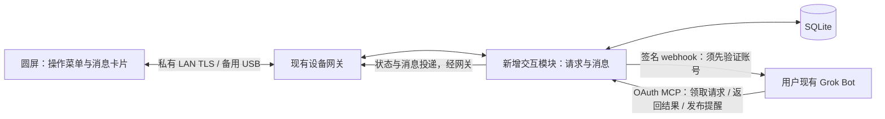

# 圆屏与 Grok Bot 双向交互规划

初稿日期：2026-10-16。以下为双向交互设计草案；2026-10-17 已先实施 BOOT 录音子集。

## 接入方式纠正（2026-10-17）

用户指出现有通讯不是 webhook。源码和运行中的工具查询确认：Grok Bot 经
Cloudflare、OAuth、Streamable HTTP MCP 访问 Mac 网关；网关经 LAN TLS 与设备
交换命令、状态和事件。现有 `gadgets_read_events` 是主动读取缓存，不会自动唤醒 Bot。

本轮新增的语音 webhook 出口没有接入这条 MCP 链路，是实现偏离，不能把它描述为
用户缺少的配置。下文 webhook 方案不再作为默认实施方向。后续应围绕现有 MCP
增加持久语音请求读取与结果回传；如何在录音完成后自动触发既有 Bot，仍须另外
验证，不能把「MCP 可读取」写成「Bot 会自动收到」。

## 2026-10-17 MCP 实施更新（以此为准）

已按用户要求重新设计并接入原有 MCP；后续改为屏幕「按住说话」，松手上传、
滑出取消。Mac 本地转写，
持久软件信箱通过现有网关暴露 `voice.claim/read/reply` 命令。回复在 Mac 渲染
中文页面，圆屏通过 HTTPS 获取，支持翻页、稍后查看和显式标记已读。
原 OAuth、Cloudflare 与六项 MCP 工具不变，已删除语音 webhook 出口。

独立 HTTPS 8768 承担音频和页面传输；软件信箱连接网关 loopback 8764。
设备仅持久化请求 ID，Mac 确认前的 PCM 仍在内存中。Bot 需主动读取信箱，
当前操作是对已有 Bot 说「处理圆屏语音」；自动唤醒尚未实现。

用法见 [BOOT 语音](boot-voice.md)，最终契约见
[MCP 语音契约](implementation/mcp-voice-contract.md)，验证记录见
[实施验证](implementation/mcp-voice-verification.md)。
以下各节是历史初稿，不代表当前架构或已交付范围；其中 webhook、网关内扩展
与触摸快捷菜单均已被本次设计取代或留待后续。

目标：在现有 SmartRing-Plus 圆屏上操作用户已有的 Grok Bot，并接收任务回复和消息。
初稿按“触摸快捷操作优先；设备任务回复＋指定提醒”规划。语音优先级现已确认采用 BOOT 两次按键；消息范围仍未确定，以下其余规划不视为已确认需求。

## 1. 第一版的使用过程

1. 平时仍显示宠物；上滑打开操作菜单，下滑打开消息页。
2. 在菜单点击“今日简报”等已配置任务，立即看到“正在发送”。
3. Mac 保存请求后显示“已收到”；Bot 真正领取后显示“处理中”。
4. Bot 返回结果，宠物出现未读提示；打开消息卡片阅读中文摘要。
5. 消息页支持翻页、返回主页和标记已读。长结果保留在 Bot 侧；只有获得真实链接时才提供对应入口。

这条完整流程是第一版的交付目标。任意聊天续聊、停止 Bot 运行、同步所有会话、语音对话均需额外接入能力，不能由现有 MCP 连接推定。

| 场景 | 操作与反馈 |
| --- | --- |
| 宠物主页 | 点击互动；左右滑换角色；摇晃保持眩晕动画 |
| 进入控制 | 上滑；点击有明确名称的快捷任务才发出 Bot 请求 |
| 阅读消息 | 下滑；卡片内滑动只翻页，不换角色、不触发宠物动作 |
| 新消息 | 持续未读点＋一次短提示动画；不强行打断正在阅读的内容 |
| 连接中断 | 显示“未连接网关”，不将 Wi-Fi 已连接等同于 Bot 可用 |
| 请求无回执 | 显示“送达状态未确认”；恢复后以同一请求 ID 查询或重传 |
| Bot 迟迟不回 | 显示“尚未收到结果”；不伪装完成，也不立即重新执行 |

手势需要统一识别：现有按住约 0.12 秒即可触发 poke，新增滑动或未来长按录音时，必须等手势判定后再派发，保证一次手势只执行一个意图。消息和菜单在独立 LVGL 层接收输入。宠物的装饰性 thinking 动画不代表真实任务状态。

## 2. 现有基础与缺口

基线为仓库 HEAD `183a4005a18ec858bd02b7daf1831e05453c2e0d`，安装的网关为 `grok-gadgets-gateway 0.1.0a14`。现有 README、部署指南和未跟踪的 HTML 使用说明已有改动，本轮保留。

| 已有事实 | 规划影响 |
| --- | --- |
| 360×360 圆屏、LVGL、ESP32-S3、8 MB PSRAM、16 MB Flash | 采用简短消息卡片；中文字体、圆形裁切和内存要实测 |
| `character.set`、`backlight.set`、`animation.trigger`、`poke` | 可沿用设备命令通道，但尚无文字消息能力 |
| `poke_event`、`shake`、`switched` | 是互动遥测，不直接当 Bot 任务入口；远程换角色也会产生 switched |
| 网关提供 `gadgets_read_events` | 只能主动读取缓存，不自动启动 Bot |
| 固件事件队列 8 条，网关默认内存事件缓存 128 条 | 不能承担可靠任务信箱；重启、溢出和发送超时可能丢失 |
| 固件命令去重仅本次启动最近 16 条 | 不能代替跨重启业务去重 |
| 当前 USB 帧及网关回复上限 2048 字节 | 正文、JSON 转义、命令外壳和 hello schema 都要计入预算 |
| BSP 有 ES8311 录音/播放代码，应用入口未初始化音频 | 有后续接入基础，尚不代表语音可用 |
| Cloudflare → Mac OAuth MCP；设备 → Mac 私有 LAN TLS | 继续沿用现有网络；Mac 需要保持运行，设备跨网另行设计 |

代码依据：[`gadget.h`](../firmware/grokbot/main/gadget.h)、[`gadget.cpp`](../firmware/grokbot/main/gadget.cpp)、[`main.cpp`](../firmware/grokbot/main/main.cpp)、[`status_bar.cpp`](../firmware/grokbot/main/status_bar.cpp)、[`bsp_audio.c`](../firmware/grokbot/components/smartring_plus/bsp_audio.c)。网关事实来自本机固定版本的 `domain.py`、`mcp_server.py`、`protocol.py` 和协议响应 schema，未修改安装文件。

## 3. 先验证 Grok 接入

官方描述了通过签名 HTTP POST 触发 Grok automation，返回 202 仅表示异步接收。[Webhook 文档](https://docs.x.ai/grok/automations/webhooks)

Grok Bot 的 routine 文档说明可在支持的集成中由事件触发；两份文档不足以证明当前账号能把 webhook 绑定到已有 Bot，或能继续同一聊天。[Bot routines 文档](https://docs.x.ai/grok-bot/skills-routines-and-automations)

**P0 必须实证**：外部请求 → 用户指定的既有 Bot → 使用其技能和当前 MCP → 回传匹配请求 ID 的结果。确认运行落在哪个会话、是否支持上下文延续、遇到授权等待时如何报告。只在其他 automation 或一个新的 API 助手上成功，不算通过。

消息回传先采用 Bot 主动调用结果工具。当前没有找到可据以承诺“所有会话实时消息订阅”的接口；MCP 连接本身也不会自动复制 Bot 的每条回答。指定提醒必须配置相应 routine/工作流调用消息工具。

Lody 本次用于发现相关历史会话；相关旧会话读取没有返回正文。其工具管理 Lody 的会话与 Agent，不能据此视为 Grok Bot 的收发接口。

## 4. 推荐结构：网关内的持久任务信箱



公网入口继续使用网关现有 OAuth MCP；新增业务工具接入同一鉴权、限流和审计边界。交互模块与网关同进程运行，但业务数据归交互模块所有，设备会话与底层命令仍归原网关所有。

实现位置为受版本控制的扩展源码，固定上游版本。如果现有网关没有稳定的事件接收和工具注册扩展点，维护最小源码分支；不能直接改 `.venv-grok` 作为交付。P0 后先验证这一接缝，再决定源码包目录。

| 状态 | 唯一拥有者 |
| --- | --- |
| 当前页面、手势、宠物动画 | 固件 UI |
| 尚未交付的请求 ID 与有限重发记录 | 固件持久 outbox |
| 请求历史、Bot 绑定、快捷任务配置、领取与完成记录 | Mac 交互模块 / SQLite |
| 消息正文、投递记录、未读状态 | Mac 交互模块 / SQLite；设备只有有限缓存 |
| Bot 实际执行与平台授权 | Grok Bot；Mac 只记录其明确报告的状态 |
| 设备会话、协议校验、传输命令 | 现有网关 |

第一版只绑定一个指定 Bot、少量快捷任务；默认同一设备只允许一个未完成任务。快捷任务先选查询、总结等无外部写入的操作。触屏确认普通选项不代表批准 Grok 的外部高影响操作，平台原有授权仍有效。

## 5. 最小契约草图

以下名称、字段均为拟议接口，尚未实现。

```text
ActionRequest = { device_id, request_id, action_id, config_version,
                  expires_at, status }
Run           = { request_id, claim_token, state, updated_at, result_id? }
InboxMessage  = { message_id, revision, request_id?, source_id?, title,
                  body, created_at, expires_at?, delivery_state, read_at? }
```

`device_id` 由已认证设备会话确定；`action_id` 映射 Mac 上配置的任务，设备不自由指定目标 Bot 或任意提示词。请求 ID 在产生用户意图时创建，重传和重启不得更换。数据库按设备与请求 ID 唯一约束，相同 ID 配不同内容返回冲突。ActionRequest.status 只描述接收与分发，Run.state 才描述执行；屏幕状态由两者派生，不再维护第三份可写状态。

设备协议新增语义：

```text
action.requested { request_id, action_id, config_version, expires_at }
interaction.update { request_id, status, error_code? }
message.put { message_id, revision, request_id?, title, body }
message.receipt { message_id, revision, phase: received | presented | read }
```

新 action 事件必须在网关事务落盘后才能返回成功响应；沿用协议允许的 `{ok:true}`，不向严格 schema 添加任意响应字段。固件收到这次请求的对应成功响应后清除 outbox；后续 UI 状态通过命令更新。当前事件的“先出队、发送失败即丢失”路径不能用于 action。expires_at 来自网关提供并绑定配置版本的有效期，网关校验，设备不能任意延长；设备重启后若无法确认旧请求的有效性，先同步历史，不自动创建新请求。

Bot 面向的工具收敛为：

```text
device_task_claim(request_id)
  -> { claim_token, action, context } | already_claimed | completed | expired
device_task_complete(request_id, claim_token, outcome, title, body)
  -> { message_id }
device_notify(source_id, device_binding, title, body, expires_at?)
  -> { message_id }
```

领取以数据库原子操作实现，回调校验绑定与领取令牌。完成工具在一个事务里更新任务和写入消息；相同结果重试返回同一消息，冲突结果明确报错。指定通知按来源 ID 去重。`device_task_complete` 的 outcome 包含成功与失败，失败也应到达用户。

两个典型调用：

- 设备点“今日简报” → 请求入库 → webhook → Bot 领取 → Bot 提交摘要 → 网关分配消息 → 圆屏显示。
- 用户配置的提醒 routine → `device_notify` → 消息入库 → 设备在线即投递，离线则保留至有效期；用户打开后另报已读。

第一版消息为纯文本摘要。建议正文初始预算 768 UTF-8 字节，之后按实际编码和字体测试调整。传输完整短消息后只由固件根据字体和屏幕做阅读分页；不引入任意大消息分片重组。

## 6. 可靠性与显示规则

- **接收边界**：认证和结构校验之后，同步将新 action 写入事务及待发送记录，提交后才响应成功。不能等之后轮询内存事件再落盘。
- **分发恢复**：请求与 webhook 待发送记录同事务写入；工作循环恢复未发送记录，记录尝试与接收结果。Mac 在提交之后、发送之前重启也不会让任务永久搁置。
- **设备掉电**：待确认请求先写入有界 NVS outbox，再发送；只有用户操作和确认更新 Flash，不按轮询频率写入。队列满明确拒绝。初始候选容量 4 条，须结合闪存与并发策略验收。
- **离线行为**：第一版离线时不接受新远程任务；已发送但未确认的请求保留同一 ID。尚未触发的旧请求有有效期，恢复时不自动执行已过期任务；Bot 已开始的任务不能因此被标为取消。
- **取消边界**：仅确定从未尝试发送的本地记录可直接取消。已经尝试发送的请求不能靠删除设备记录取消；第一版不提供远程停止按钮。
- **重启去重**：网关的业务唯一键独立于设备会话、事件游标和网关进程 epoch；旧设备事件和重复 webhook 都不能创建第二个可见任务。
- **触发不确定**：HTTP 超时与 202 分别记录为“是否接收未知”和“平台已接受”。使用稳定业务 ID；不假定平台按 webhook ID 保证只运行一次。重试用当前签名时间，领取工具负责拦截重复工作。
- **领取后中断**：超时进入“结果待核实”，保留迟到结果通路。不自动重新执行已领取的任务，也不承诺外部副作用 exactly-once。第一版由用户在 Bot 原会话核实；确认需要重试后建立显式关联旧任务的新请求。旧领取令牌只能完成旧任务，不能覆盖新结果。
- **消息重放**：按消息 ID、revision 幂等更新，重复投递不新增卡片。Mac 保留完整记录，设备重新连接后同步未读消息；过期提醒不补发。
- **消息确认**：Mac 已保存为数据库事实；received 表示设备已接入易失缓存，不承诺掉电保存；presented 表示卡片已成为当前页面并完成 UI 更新；read 只在用户明确标记后产生。三种 receipt 均按消息与 revision 幂等。命令 executed 不能代替 presented/read，UI 回执也不等于物理显示证明；验收仍须目视真机。
- **帧预算**：校验实际序列化后的完整帧，包含 UTF-8 和 JSON 转义；同时测试新增能力后的 hello。若超过 2048 字节，必须显式缩减契约或协调两端协议上限，不能只调本地缓冲。
- **UI 线程**：网络和 SQLite 不阻塞 LVGL；命令经校验后的类型进入队列。卡片开启时暂停被覆盖的宠物画布刷新，关闭后恢复，实测帧率及 DMA 内存余量。
- **字体**：引入有明确授权的中文字体及缺字回退，测试常用汉字、英文、标点、长单词、换行与不支持的 emoji。BSP 和现有数字状态栏不构成中文支持证明。
- **运行条件**：把网关与隧道的自动启动、退出恢复、Mac 睡眠提示列为可日常使用的交付项；自动启动不能解决 Mac 睡眠时不可达的问题。

## 7. 结构比较

| 方案 | 状态与触发归属 | 收益 | 代价与结论 |
| --- | --- | --- | --- |
| 网关内交互模块＋webhook | 同一进程持久接收；Mac 触发 Bot | 可在设备确认前落盘，复用一个 MCP/OAuth 入口 | 需要维护网关扩展；推荐，前提是 P0 接入通过 |
| 独立 companion 服务 | companion 保存任务，读取网关事件并触发 Bot | 业务与上游网关发布隔离 | 现有事件读取会丢且不持久，仍需网关改造或第二条可靠通道；另增进程/鉴权；暂不选 |
| Bot 定时拉取信箱 | Mac 存请求，Bot routine 定时领取 | 不需要外部 webhook 唤醒 | 有周期等待和空轮询成本，需实际账号验证；是可与前两种部署组合的触发方式备选 |

直接调用 xAI 模型 API 会形成另一套助手和会话，不自动继承现有 Grok Bot 的上下文、技能与授权，因此不作为本目标的默认替代。

设计来源：两个独立候选会话完成后，由第三个独立会话按既有 Bot 一致性、圆屏体验、状态归属、可靠性及分阶段验收五项标准评判。使用相同默认模型，未进行跨模型实验。选择 B 的持久请求信箱，吸收 A 的明确模块边界与有限消息预算；拒绝 A 允许未确认请求在设备掉电时丢失的方案，也不采用 B 未协调网关的离线取消。主会话复核后补充同步落盘确认、分发恢复、迟到结果和独立消息回执。本过程是设计审查，不是运行验证。

## 8. 实施顺序与验收

| 阶段 | 交付 | 通过条件 |
| --- | --- | --- |
| P0 接入验证 | 一次无副作用的真实 Bot 触发与结果回传 | 目标既有 Bot 正确接收，request ID 完整往返，明确会话归属；202 不算完成 |
| P1 消息显示 | 中文卡片、未读、分页、返回主页 | Mac 发一条消息在真机可读，重复投递不重复，旧宠物交互正常 |
| P2 可靠操作 | 菜单、持久请求、领取与状态回执 | 在网关事务前后断线/重启、设备掉电、队列满时不静默丢失或重复生成任务 |
| P3 完整闭环 | 一个快捷任务＋一种指定提醒 | 真实触摸→目标 Bot→中文结果；验证失败、迟到、超长、提醒过期和补发 |
| P4 日常运行 | 启停恢复、有限消息保留、连接诊断 | Mac/设备分别重启后恢复；睡眠/隧道故障呈现真实状态 |
| P5 语音扩展（按需求） | 按住说话、转写确认、同一 Bot 执行、结果播报 | 实测麦克风和扬声器、音频上传/播放、打断、内存；不把实时语音 API 当成既有 Bot |

P1 前可用模拟结果检查布局，但不能称为真实 Bot 闭环。P0 未通过时保留 UI 原型价值，先解决账号入口再推进绑定实现。

首个端到端验收脚本：上滑 → 点“今日简报” → 一次有效请求 → Bot 领取并返回短中文 → 圆屏出现一张消息 → 阅读并标记已读。重复同一网络请求、远程 poke 和远程换皮肤均不得额外启动任务。

## 9. 尚待确定

- 用户偏好：消息是否只含设备任务和指定提醒，还是要求指定/全部会话。BOOT 两次按键语音已确定。
- 账号证据：目标 Bot 的 webhook 或其他可用触发入口、MCP 权限、同会话关联、运行查询/取消能力。
- 工程验证：网关可靠接收扩展点、hello 剩余字节、中文字体预算、NVS outbox 和音频资源。
- 多轮交互：如需要“继续/换一个/追问”，后续增加与具体消息及任务绑定的有限 action，不把屏幕按钮直接当平台审批。

初稿规划阶段没有修改产品或运行配置。后续 BOOT 实施范围见顶部更新；仍未发送真实 Bot 任务。
